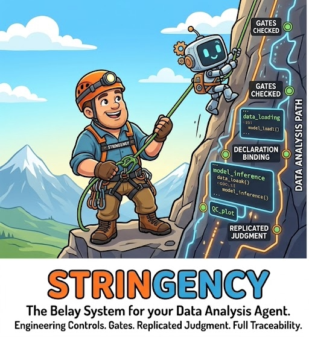

# stringency

<p align="center">
  
</p>

## What this is

Ever been rock climbing? Stringency is the belay system for an agent doing your data analysis.

The agent is the climber. It writes the code, runs the steps, reads the outputs, and proposes what
to do next. That part it is good at, and a scientist who knows their own data and can ask a sharp,
verifiable question is well placed to direct one. Often better placed than a handoff to someone who
has never seen the sample.

What agents are bad at is falling safely. A model that hits a roadblock reaches for the next
plausible approach, and then the one after that, without flagging that it has left the conventional
path. A model that asserts something false about your data will happily build on it for hours. When
the session ends the reasoning ends with it, and the spreadsheet left on your desk has no answer to
"how did you get this?" or "why this way?"

### What it does not do

A belay does not make anyone a better climber. It makes falling survivable, and it makes the falls or missteps
visible.

stringency will not make an analysis correct, and it is not a substitute for knowing what you are
doing. It holds an agent to a path you declared, stops it where a person should be looking, and
leaves a record complete enough to answer "how did you do this?" and "why this way?" months later.
The science is still yours.

## Design

<p align="center">
  
</p>

A human sets the scientific goal and directs an AI operator, which runs the analysis and delegates step-specific judgments to independent judgment agents. The engine checks each proposed step, validates outputs and judgments, and pauses when a human decision is required. It records the actions, evidence, and decisions behind the results.

**Methods define the analysis plan; plugins supply domain knowledge; the engine enforces the rules.** Method repositories contain versioned pipelines, module code, parameters, prompts, policies, and environment specifications. Plugins provide domain tools and contracts, including state extractors, predicates, schemas, and vocabularies. The engine remains domain-free, so the same execution, validation, and provenance machinery can support different scientific domains.

Results are delivered with an auditable history: what ran, what was checked, what the agents judged, and what a person decided. Versioned methods, hashed inputs, recorded environments, and explicit review decisions support reproducibility and make limitations visible.

The architecture is specified in `spec/stringency-design.md`; `spec/README.md` guides readers through the supporting documents. The motivation and twelve design constraints are in `spec/commandments.md`, implementation decisions in `spec/DECISIONS.md`, and contract deviations in `spec/DEVIATIONS.md`. Current plans live in `spec/plans/`.

### More Climbing Analogies

- **The route is bolted in advance.** The pipeline topology, the modules, their parameters and
thresholds, the prompts, the gate implementations and the controlled vocabularies all live in a git
repository, pinned to a tag, committed before anything runs. The agent routes within that topology.
It does not invent an analysis plan when it meets new data. A dirty working tree is not a valid run.

- **You check the knots before anyone leaves the ground.** `init` binds a project to one pipeline,
one objective, one design and one set of hashed inputs, then echoes back its own reading of those
declarations. Nothing runs until the owner accepts the echo-back. If the engine has misread what
your experiment is, you find out then rather than four hours in.

- **The belay device is passive.** Gates are pure functions over a declared state: no I/O, no clock,
no randomness. The agent's reasoning is not one of their inputs, so they cannot be talked around. A
gate fires or it does not, and one that fires with `block` stops the step. It does not warn and
continue, and the message it prints never suggests a way around itself.

- **Judgment is replicated, not trusted once.** Where a call genuinely needs a model, such as
labelling a cluster or reading a QC plot, it is made several times independently, the replicates are
compared, and disagreement or low confidence becomes a hold rather than a majority vote. Abstaining
is always an allowed answer. Arithmetic is never a judgment call: anything that can be code is code,
and a model that proposes a statistical test has its assumptions checked against the data before
that test is allowed to run.

- **Someone is on the other end of the rope.** A hold names a person and waits. Their verdict, the
hashes it was made against, the timestamp and the reason all go into the record beside the model's
output, with the same rigor applied to the human call as to the model's.

- **Every move is logged.** The trace is an append-only SQLite database, enforced at the trigger
level: every action proposed, every gate verdict and the evidence it inspected, every model
invocation with its cost, every human review, every output with its hash. The trace is the product;
the code exists to fill it correctly.

## Status

Early. Initial build out for the engine is done, but I'm still actively working on plugins, and methods for real data analysis pipelines. 

The API is not stable yet. One real plugin (`stringency-singlecell`) and one real method (the Xenium
TMA method) exist and have taken a study from QC to annotated cells; `compat/known-good.yml` lists
the engine, plugin and method versions that ran together. Guides: `docs/install.md` (setting up a
machine), `docs/onboarding.md` (joining one), `docs/method-author.md` (writing a method).

## Install

**If you are a person,** do not follow a checklist. Open Claude Code, Codex, or any AI that can run
commands on the machine the data lives on, and paste this:

> Install stringency on this machine: run
> `curl -LsSf https://raw.githubusercontent.com/santangelo-lab/stringency/main/scripts/bootstrap.sh | bash`,
> then follow `docs/install.md` in the stringency repository for the rest, and tell me when
> `stringency probe` ends with "ready" or what stands in the way.

That installs a known-good engine and plugin, puts the skills the AI needs beside them, and ends
with a report of what is there and what is missing. On a shared machine add `--prefix` with the
group's directory (`bash -s -- --prefix <prefix>`). To join a machine someone
else set up, read `docs/onboarding.md` instead: it is one group membership, one PATH line, and an
AI session of your own.

**If you are the AI** doing the install, `docs/install.md` is yours: what gets installed where,
the container images, the console, and how to check your work. **If you maintain an
install,** `docs/release.md` is the one page of recurring jobs: release, install, restart, republish.

## Develop the engine

```
uv sync --all-groups
uv run pytest
uv run stringency --help
uv run stringency plugins list
```

That runs the tests and the toy plugin with the local executor; nothing else is needed on a
developer's machine. The checks CI runs are `uv run ruff check . && uv run ruff format --check . &&
uv run mypy && scripts/check_no_biology.sh`.

## The CLI in brief

A project is bound with `init`, its echo-back accepted with `review`, and then driven by `run`:

```
stringency init <dir> --method <git-url>@<tag> --pipeline <name> \
    --objective objective.yml --design design.yml --inputs inputs.yml \
    [--profile standard] [--judgment-harness subagent] [--executor apptainer]
cd <dir>
stringency review --verdict accept --hold <id> --reason "..."   # the owner accepts the echo-back
stringency run          # exit 21: a ticket; run its `exec` line, then its `submit` line
stringency run          # exit 20: judgment requests written; subagents answer, then run again
stringency run          # exit 10: a hold; `stringency review` shows it
stringency deliver      # on a completed run: finals, coverage.md, methods.md, index.json
```

`run` is the loop: each call either advances the pipeline or stops and tells you why. Exit codes are
in design 14.2. Every verb takes `--json`.

## Claude Science setup

The general setup is `docs/install.md` and `docs/onboarding.md`; this section is the Claude
Science-specific part. The skills a session needs are published by pasting one message into a
session (`integrations/claude-science/publish-skills.md`, "For a person").

>[!Note]
>I'm working on making stringency accessible to many different kind of operators through different AI harnesses. The one I'm using at the moment is Claude Science so here I'm including specific details for it. Hopefully more to come soon!

A Claude Science session drives a project as its operator: it calls the CLI, runs the steps the
engine hands it, and answers judgment dispatches with fresh delegates. The session's sandbox
cannot start containers, so the engine runs on the workstation that holds the data and the
container runtime, and the session reaches it as an SSH compute provider. The full checklist is
`integrations/claude-science/new-project.md`; in outline:

1. On the workstation, once: `scripts/install.sh --prefix <shared dir>` puts a versioned engine
   under `<shared dir>/current/bin`; `stringency probe --method <url>@<tag>` confirms the method's
   images and versions are there.
2. In Claude Science, once per instance: add the workstation as an SSH compute provider, set the
   project area as a data root, paste the publish message (`integrations/claude-science/publish-skills.md`).
3. Per project: render the agent context and the session brief from the project with
   `integrations/claude-science/render_brief.py`, paste the context into the project's Agent
   Context, paste the brief as the first message, and accept the confirm hold at your terminal
   when the agent reports it. Every later hold comes back to you the same way.


## Layout

```
src/stringency/         the engine (no biology imports; CI checks)
plugins/stringency-toy/ reference plugin, its method repo, fixtures
templates/method-repo/  what a new method repository starts from
integrations/           Claude Science: the skills, the brief renderer, the setup checklist
docs/                   the guides: install, onboarding, method author, release; README assets
compat/                 known-good combinations of engine, plugin and method
spec/                   design, build plan, contracts, decisions
notes/                  session notes; read INDEX.md first
tests/                  one file per milestone area; mock harness and local executor only
```
